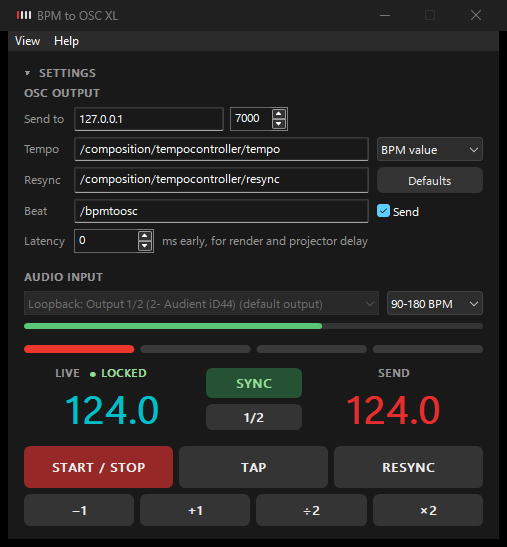
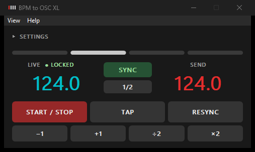
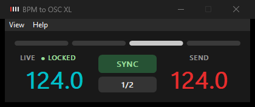

# BPM to OSC XL

Listens to music, finds the beat and sends tempo, beat and phase over OSC, to keep visuals in Notch,
Resolume, TouchDesigner or any other OSC capable software in time with the music. Runs on Windows.

Based on [BPMtoOSC by d00mfish](https://github.com/d00mfish/BPM-to-OSC), see [Credits](#credits).

## Features
- **Real-time beat tracking**, tuned for electronic music as well as rock and pop: works with a quiet kick,
  holds the tempo through breakdowns, nothing looks ahead.
- **Beat and phase over OSC**, not just a tempo number: the receiver can follow the music's beat directly
  instead of running its own clock, which drifts away from the music over time.
- **Listens to the PC itself** ("Loopback"), or to any audio input, no cables or virtual audio devices needed.
- **Detection status**: LOCKED, COASTING (no clear beat, the clock carries on), LISTENING, NO SIGNAL.
- **Tap tempo, resync, half time, +1 / -1, x2 / /2**, all on the keyboard, resync also while another program
  has the focus.
- Compact mode, foldable settings, always on top, latency compensation.

## Quick start
1. Download `BPM_to_OSC_XL.exe` from the [Releases](../../releases) and run it, no installation needed.
2. **Send to**: IP address (or computer name) and port of the program receiving the OSC messages.
3. **Audio input**: a sound card input, or "Loopback: ... (default output)" to listen to what this PC plays.
4. Press **START / STOP** (F5). After a few seconds of music the status shows LOCKED and the tempo is sent.
5. Press **RESYNC** (R) on the first beat of a bar to set where the bar starts.

## OSC messages

| Address | Value | When |
| --- | --- | --- |
| `/composition/tempocontroller/tempo` | the tempo, as BPM (e.g. 125.4) or Resolume's 0-1 range | when it changes and once a bar |
| `/composition/tempocontroller/resync` | 1 | when Resync is pressed |
| `/bpmtoosc/beat` | 1-4, the beat of the bar | on every beat |
| `/bpmtoosc/snare` | 1 on beats 2 and 4 (the backbeat), 0 on 1 and 3 | on every beat |
| `/bpmtoosc/phase` | 0-1 through the current beat | 60 times a second |
| `/bpmtoosc/bar_phase` | 0-1 through the current bar | 60 times a second |

All addresses can be changed in the settings, "Defaults" resets them (the tempo and resync defaults are
Resolume's tempo controller). Choose "BPM value" to send the plain tempo, "Resolume (0-1)" for Resolume.
The beat messages can be switched off with "Send". Help → OSC messages lists them with the current settings.

**In Notch**, receive the values with an OSC Modifier. Driving animations from `phase` or `bar_phase` keeps them
locked to the music; a BPM Modifier runs its own clock, which slowly drifts away even with the right tempo.
If the visuals end up behind the music (render and projector delay), set **Latency**: beats and phase are then
sent that many milliseconds early.

## Audio input
Pick a sound card input, or a **Loopback** source to listen to what this PC itself plays on one of its outputs
(e.g. the music player, DJ software or Notch on the same machine). "(default output)" marks the output Windows
plays to by default. Loopback sends nothing while the output is silent, the status then shows NO SIGNAL and the
beat clock carries on.

Software that plays through ASIO or WASAPI exclusive mode (many DJ programs and DAWs) bypasses Windows' mixer,
loopback doesn't hear it. Use a loopback input of the sound card or an input from the mixer then.
"Microsoft Sound Mapper" is not the PC's sound, it is whatever Windows has set as default recording device
(often a microphone or webcam).

The tempo range (e.g. 90-180 BPM) sets which tempo is reported when the music could be counted at half or double
speed: a 174 BPM track isn't reported as 87.

## Status and beat lights
Next to the live tempo:
- **LOCKED**: clear beats in the music, the tempo and beat follow it.
- **COASTING**: no clear beat right now (e.g. a breakdown), the clock carries on at the last tempo and phase.
- **LISTENING**: finding the tempo, takes a few seconds of music.
- **NO SIGNAL**: the input is silent.

The beat lights show the beat of the bar, beat 1 in red.

 

## Keyboard

| Key | Action |
| --- | --- |
| Space | Tap tempo |
| R | Resync bar |
| S | Toggle sync (follow the music) / manual |
| H | Half time |
| Up / Down | +1 / -1 BPM |
| Right / Left | x2 / /2 BPM |
| F5 | Start / Stop |
| Ctrl+E | Show / hide settings |
| Ctrl+M | Compact mode |
| Ctrl+T | Always on top |
| F1 | Shortcut help |
| Ctrl+Alt+R | Resync bar, also while another program (e.g. Notch) has the focus |

The global resync key can be switched off in the View menu and changed with `global_resync_key` in the `[UI]`
section of the settings file (e.g. `F9`, `Pause`, `Scroll_Lock`, `Ctrl+Shift+R`). While the app runs, other
programs don't get that key combination.

Settings are stored in `%APPDATA%\BPM_to_OSC_XL\lastsession.ini` (settings of the original BPMtoOSC are taken
over the first time). Delete the file to reset everything.

## How the detection works
Everything runs in real time (`tracker.py`, `beatclock.py`):
- Onsets are measured in three frequency bands (kick, snare / guitar, hats), each scaled to its own recent level,
  so a kick low in the mix or a snare carrying the beat still counts.
- The tempo comes from how regularly the onsets repeat over the last 8 seconds, folded into the tempo range.
  It sticks to the current tempo unless a new one clearly wins for a while.
- The phase comes from folding the last 8 beats of onsets onto one beat cycle. How clearly the beat stands out
  is the confidence: in breakdowns it drops, and the beat clock coasts instead of following pads and vocals.
- A beat clock drives the beat lights and all OSC output. Detected beats steer it, tap tempo and the tempo
  buttons set it by hand. Resync restarts the bar; when following the music, beat 1 snaps to the nearest beat.

On five test tracks (rock, pop, blues, electronic), compared with an offline reference tracker, about 83 % of the
beats land within 70 ms of the reference beats (the aubio based detection of the original: about 80 %), with the
gains on rock with a quiet kick and after breakdowns. A live recording with a drifting shuffle stays difficult.

## Building
Needs Python 3.13. `build_exe.bat` installs the packages from `requirements.txt` into a build environment in
`%LOCALAPPDATA%\BPM_to_OSC_XL-build` and builds `output\BPM_to_OSC_XL.exe`.
To run from source: `pip install -r requirements.txt`, then `python main_gui.py`.

## Credits
BPM to OSC XL started from [BPMtoOSC](https://github.com/d00mfish/BPM-to-OSC) by Leonhard Axtner (d00mfish),
whose idea, interface design and OSC client this builds on. The original beat detection there was inspired by
[aubio-beat-osc by DrLuke](https://github.com/DrLuke/aubio-beat-osc). The git history keeps the original
project's commits, followed by the changes made here.

### Changes from the original (2026, Mike Wilson)
- Own real-time beat tracker instead of aubio, a beat clock steered by it, coasting through breakdowns.
- Tempo sent with decimals; beat, snare, phase and bar phase messages; latency compensation.
- Resync starts beat 1 immediately with a full beat; snaps to the music's beat when following it.
- Loopback input (what the PC plays), sample rate handling, level meter in dB, detection status.
- New dark interface, compact mode, foldable settings, keyboard shortcuts, global resync hotkey.
- Python 3.13 with current packages (was 3.9), build script for the executable.

## License
GNU General Public License v3.0, like the original, see [LICENSE](LICENSE).
Copyright (C) 2022 Leonhard Axtner, Copyright (C) 2026 Mike Wilson.
